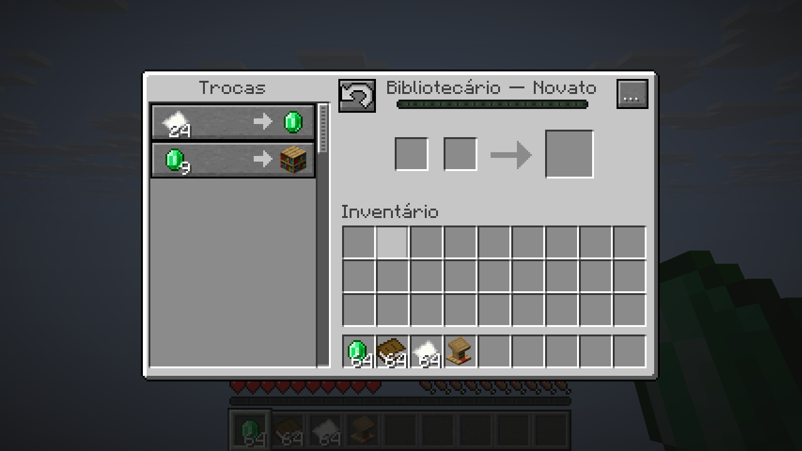
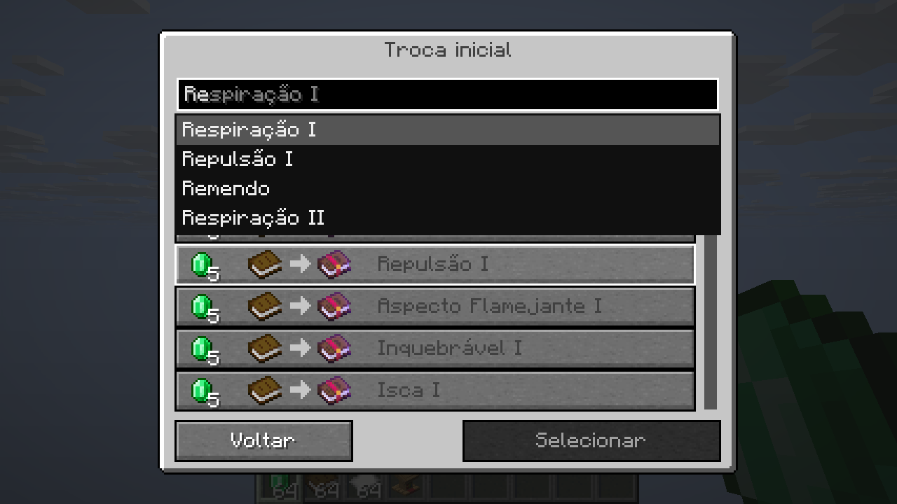
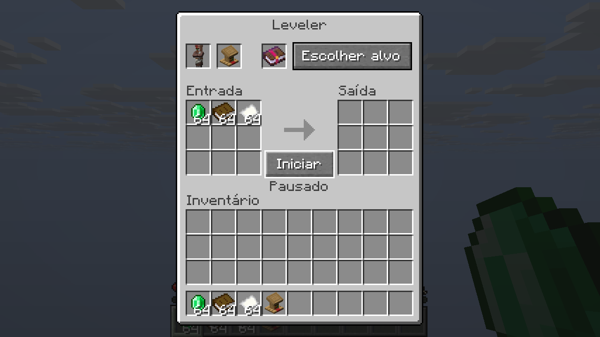
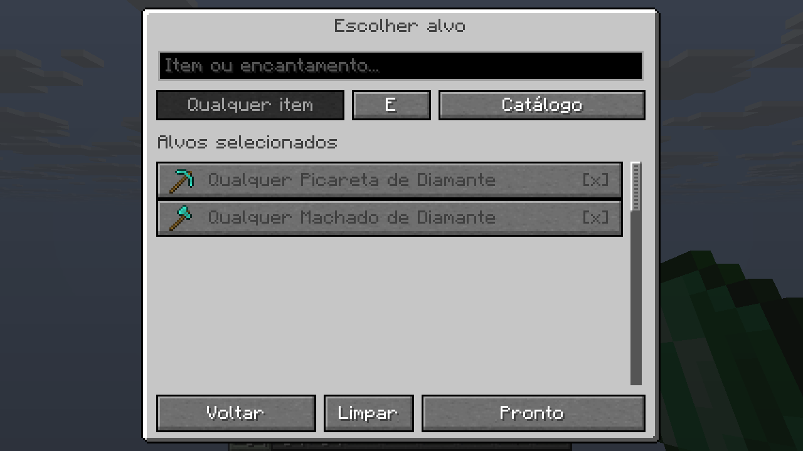
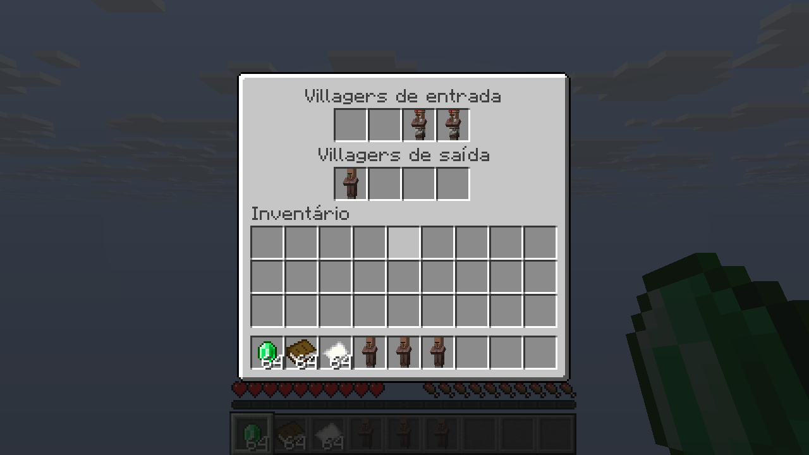
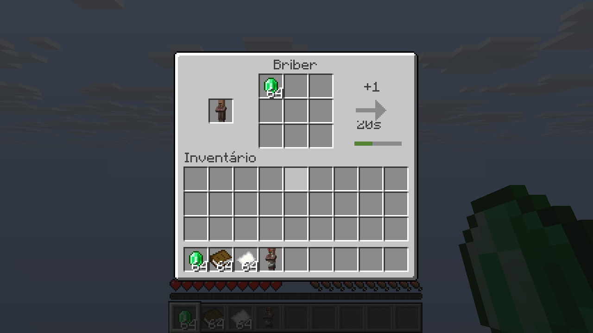

# Gash's Easy villager Addon

Autor: **Gasharaujo**

Mod ID: `gashs_easy_villager_addon`

Dependência obrigatória: [Easy Villagers](https://github.com/henkelmax/easy-villagers), de henkelmax.

## Estado do projeto

Versão de desenvolvimento `0.4.1-dev`, com quatro blocos e telas específicas:

- **Advanced Trader:** escolhe uma troca de um villager de nível 1 sem XP e repete
  o sorteio normal do Minecraft até encontrá-la. Preserva o conjunto completo
  daquela tentativa, com preço aleatório, ordem e trocas acompanhantes naturais;
  não injeta a prévia do catálogo no villager. Mostra somente alvos de nível 1.
  Todas as trocas ficam
  disponíveis sem esgotamento enquanto o villager estiver neste bloco.
- **Desneuralizer:** recebe villagers em quatro slots de entrada e entrega-os
  em quatro slots de saída, como o Incubator. Remove profissão, nível, XP e
  ofertas, preservando identidade, idade, bioma, inventário e reputação.
- **Briber:** consome 32 esmeraldas por 400 ticks (20 segundos a 20 TPS) e dá
  exatamente +1 de reputação positiva ao jogador que colocou o bloco. Pausa
  sem esmeraldas e deixa de cobrar no limite vanilla dessa reputação (200 no
  1.20.1; 25 no 1.21.1 e 26.1.2).
  A configuração de reputação universal do Easy Villagers continua aplicável.
- **Leveler:** seleciona até 32 alvos exatos ou genéricos, cada um com seu nível.
  Negocia com os insumos fornecidos e guarda os produtos na saída. **OU (OR)**
  para ao encontrar qualquer alvo; **E (AND)** exige todos no mesmo villager.
  Se a condição não for cumprida até o maior nível selecionado, reinicia
  profissão, nível e XP e repete.
  Executa a cada tick e conclui até uma tentativa por tick, com limite de 64
  negociações pagas por tick. Se precisar de mais, continua no tick seguinte;
  falta de insumos, estoque esgotado ou saída cheia interrompem o processamento.
  Os insumos consumidos em tentativas anteriores não são reembolsados.

O Advanced Trader faz até 32 sorteios naturais por tick. O Briber mantém seu
intervalo de 400 ticks; o Desneuralizer processa um villager a cada 20 ticks.

Villagers bebês não são processados. Advanced Trader e Leveler atribuem a
profissão da estação a villagers sem XP; villagers já negociados mantêm sua
profissão até passar pelo Desneuralizer ou reinício do Leveler.

## Interface e pesquisa

Clique com o item de villager para inseri-lo. No Advanced Trader e no Leveler,
clique com uma estação de trabalho para inseri-la. Outro clique abre a interface.
No Desneuralizer, o villager entra na fila de processamento.
Com a mão principal vazia, **Shift + botão direito** retira primeiro o villager;
outro clique após guardar o villager retira a bancada. Funciona também com um
item na outra mão, como nos blocos do Easy Villagers. Aplica-se a Advanced Trader,
Leveler e Briber; o Desneuralizer entrega villagers pelos slots de saída.

O **Advanced Trader** usa o fundo da negociação vanilla: ofertas à esquerda,
pagamento e resultado à direita, barra de XP e inventário abaixo. O pequeno botão
de ciclo abre a seleção inicial; o botão `…` abre os slots de villager e profissão.
Os slots de pagamento e resultado usam o contêiner de negociação vanilla,
incluindo consumo dos itens, XP, estatísticas e descontos. Shift-clique funciona
no inventário e no resultado. A seleção de uma oferta preenche o pagamento com
itens do inventário, como na tela normal de negociação.

O **Desneuralizer** usa o mesmo fundo de entrada/saída do Incubator, sem botões
de negociação. O **Briber** mostra somente villager, esmeraldas e progresso;
o tooltip do progresso informa custo, reputação e tempo. O **Leveler** mostra
villager, profissão, alvo, nove slots de insumos e nove de produtos. O botão
**Escolher alvo** abre a seleção; **Iniciar/Pausar** controla a automação.
Esses três blocos não permitem compras manuais, inclusive pelo protocolo de rede.

Na seleção do **Leveler**, alterne **Troca exata / Qualquer item**. O modo genérico
aceita qualquer oferta que produza aquele item, ignorando encantamentos, demais
componentes, preço e pagamentos. Por exemplo: qualquer picareta de diamante do
ferreiro de ferramentas. O modo exato preserva os componentes do resultado e os
tipos de pagamento; os preços continuam sendo sorteados naturalmente.
Clique nas linhas para marcar/desmarcar vários alvos. A troca de nível preserva
as seleções anteriores. **Alvos: N** revisa a lista de todos os níveis e permite
remover cada alvo; **Limpar** remove todos. **OU/E** define a condição de parada.
**Pronto** volta ao inventário, onde **Iniciar** começa a automação.
Os alvos e o modo OU/E são salvos; configurações antigas de alvo único são migradas.

Na janela de seleção do Advanced Trader/Leveler, o campo filtra enquanto se digita. Inclui
autocomplete de nomes de itens e encantamentos, com sugestões clicáveis,
setas para navegar e **Tab/Enter** para completar. Acentos e maiúsculas são
ignorados. Os nomes seguem o idioma do cliente; encantamentos vanilla também
aceitam termos em português como `remendo` e `fortuna`. As prévias de ofertas
são elementos da interface e não ocupam slots de inventário.













O catálogo consulta as fábricas de trocas do pack no Forge 1.20.1 e NeoForge 1.21.1,
incluindo rebalanceamento experimental quando habilitado. No 26.1.2, consulta
os registros de conjuntos de trocas e suas condições. Não introduz ofertas
por uma lista fixa independente do pack. Explora variantes em lotes, até 4096
combinações por fábrica e 4096 entradas por catálogo. Geradores personalizados
podem ter variantes adicionais além desse limite. Reconstrói o catálogo ao abrir
o bloco ou alterar nível/estação, sem cache global de ofertas antigas.

Retire villager/estação pelo respectivo slot real da interface; no Advanced Trader,
abra `…`. No Desneuralizer, retire os villagers processados da saída.
Funis inserem insumos por cima/laterais e extraem produtos por baixo.
Quebrar o bloco solta villager, estação e inventário; use picareta para receber
também o bloco. O estado é salvo ao descarregar chunks ou fechar o mundo;
ao quebrar a máquina, suas configurações são reiniciadas.

## Versões

| Diretório | Minecraft | Loader de desenvolvimento | Java |
| --- | --- | --- | --- |
| `forge-1.20.1` | 1.20.1 | Forge 47.4.10 | 17 |
| `neoforge-1.21.1` | 1.21.1 | NeoForge 21.1.248 | 21 |
| `neoforge-26.1.2` | 26.1.2 | NeoForge 26.1.2.98 | 25 |

Todos os intervalos de dependências nos metadados usam apenas um mínimo,
no formato `[mínimo,)`, sem versão máxima. Isso não garante compatibilidade
com versões futuras: utilize o JAR correspondente à versão alvo da tabela.

As versões exatas de Easy Villagers em `gradle.properties` servem para obter
um ambiente de desenvolvimento reproduzível. A dependência de execução usa
`[1.1.39,)` no Forge e `[1.1.47,)` no NeoForge, sem limite superior.

## Compilar

Entre no diretório da versão desejada e execute:

```powershell
.\gradlew.bat build
```

Linux/macOS: `bash ./gradlew build`. Configure `JAVA_HOME` para o JDK indicado
na tabela. Os arquivos finais ficam em `build/libs` de cada diretório.
O Gradle baixa Easy Villagers do Maven público do Modrinth para o ambiente
de desenvolvimento; a dependência não é embutida no JAR do addon.

## Executar em desenvolvimento

No diretório da versão desejada, execute `gradlew.bat runClient` ou
`gradlew.bat runServer`. O primeiro início do servidor exige aceitar a EULA
do Minecraft no diretório de execução gerado.

## Instalar

Instale o loader adequado, Easy Villagers para a mesma versão do Minecraft
e o JAR correspondente deste addon na pasta `mods`. O addon é necessário
tanto no cliente quanto no servidor. Não instale JARs de versões diferentes
do addon ao mesmo tempo.

## Integração contínua

O GitHub Actions compila as três versões em cada push e pull request e
disponibiliza os JARs como artefatos da execução. Isso verifica a compilação;
o carregamento em jogo deve ser validado separadamente.

## Código compartilhado e testes

`common` contém o comportamento e os modelos, que usam texturas vanilla.
Cada versão adapta registro, persistência, rede e renderização. As telas usam
widgets nativos, slots de negociação vanilla e pacotes próprios para estado
e catálogo. O servidor valida a distância, o menu aberto e a revisão do catálogo
antes de aceitar uma seleção.

Com o JDK correspondente em `JAVA_HOME`, execute na raiz:

```powershell
.\verification\verify.ps1 -Target neoforge-1.21.1
```

O teste cria um servidor isolado em `build/verification-run`, limitado à rede
local do computador e com aceitação da EULA para esse ambiente de teste.
Verifica catálogo, encantamentos, seleção, estoque ilimitado, reputação,
consumo, reinício/parada do Leveler, persistência, tipos de slots, pagamento,
retirada do resultado e XP concedido pela negociação vanilla.
Habilitado apenas com `-Pverification`; classes/mods de teste são excluídos do
JAR normal. O perfil adicional `-PuiVerification` abre um mundo de teste em
`build/ui-client/saves/GashUiTest`, exercita seleção, autocomplete e uma compra
real pelo cliente e salva capturas em `build/ui-client/screenshots`. Esse mundo
deve existir antes do teste; pode ser copiado do mundo do servidor de verificação.
